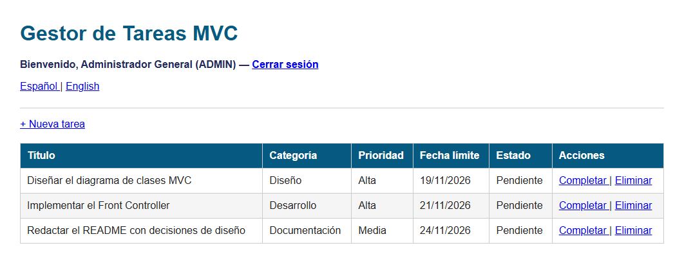
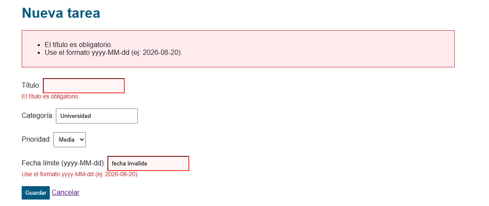
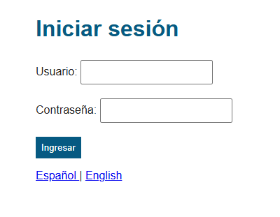
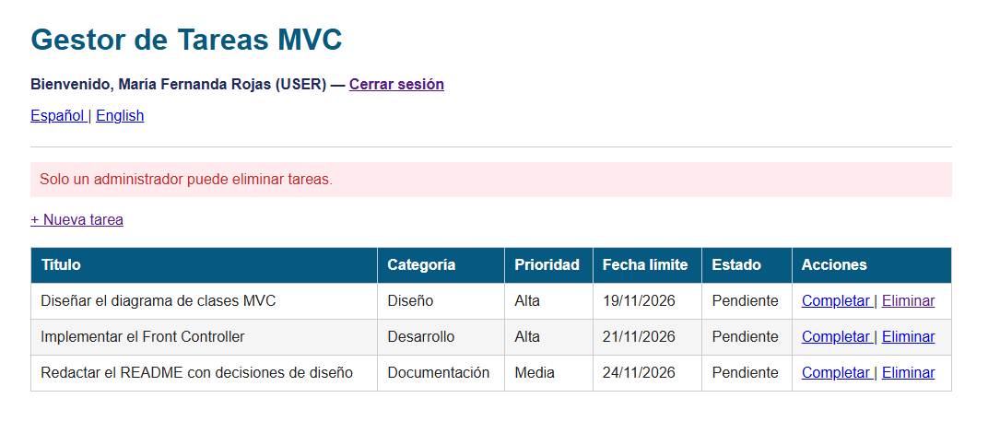
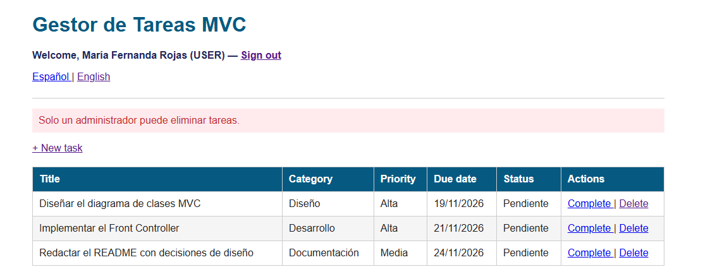

# Post-contenido — Unidad 6: JSP con MVC

**Estudiante:** William Felipe Villamizar Soler  
**Código:** 1152498  
**Programa:** Ingeniería de Sistemas  
**Semestre:** Séptimo  
**Asignatura:** Programación Web

## Descripción

Repositorio del laboratorio de la Unidad 6 de Programación Web.

Contiene un único proyecto Maven Web llamado `gestor-tareas-mvc`, que implementa el patrón MVC mediante un Front Controller y el patrón Comando.

La Parte 1 desarrolla el CRUD de tareas. La Parte 2 extiende la aplicación con autenticación, roles, validación por campo e internacionalización.

## Tecnologías utilizadas

- Java 17
- Maven
- Jakarta Servlet 6.0
- JSP, JSTL y Expression Language
- Apache Tomcat 10
- HTML5 y CSS3
- HttpSession y Cookies
- ResourceBundle
- Git y GitHub

## Parte 1 — Front Controller y patrón Comando

`FrontControllerServlet` es el único punto de entrada de la aplicación, mediante la ruta `/app`.

El controlador delega las operaciones en objetos que implementan la interfaz `Comando`:

- ListarComando
- FormularioComando
- GuardarComando
- EliminarComando
- CompletarComando

`TareaService` contiene la lógica de negocio y `TareaDAO` administra los datos almacenados en memoria.

Las vistas JSP utilizan JSTL y Expression Language para presentar la información.

Se utiliza el patrón Post/Redirect/Get para las operaciones de modificación.

## Parte 2 — Sesión con roles, validación por campo e i18n

### Autenticación y sesiones

Se implementaron `Usuario`, `UsuarioDAO` y `AutenticacionService`.

`LoginComando` permite autenticar usuarios y almacenar su información en `HttpSession`.

`LogoutComando` invalida la sesión activa.

El Front Controller verifica la existencia de una sesión antes de ejecutar comandos protegidos.

### Control de acceso por roles

Se utilizan dos roles:

- ADMIN: puede consultar, registrar, completar y eliminar tareas.
- USER: puede consultar, registrar y completar tareas, pero no eliminarlas.

La autorización para eliminar se comprueba en `EliminarComando`.

### Validación por campo

`GuardarComando` valida individualmente:

- Título obligatorio.
- Longitud máxima del título: 80 caracteres.
- Categoría obligatoria.
- Prioridad válida: Alta, Media o Baja.
- Fecha límite con formato válido y no anterior a la fecha actual.

Los errores se almacenan en un mapa y se muestran junto a sus campos.

El formulario conserva los valores introducidos cuando ocurre un error.

### Internacionalización

`IdiomaComando` permite seleccionar español o inglés.

La preferencia se almacena en la cookie `idiomaPreferido`, con una duración de 30 días.

Los archivos de traducción son:

- `messages.properties`
- `messages_es.properties`

Las vistas consultan la cookie mediante Expression Language y utilizan JSTL `fmt:message` para mostrar los textos correspondientes.

## Decisiones de diseño

### 1. Comandos y vistas lógicas

Cada objeto `Comando` devuelve la ruta de la vista JSP que debe mostrarse.

Cuando el comando ya envió una redirección, devuelve `null`.

De esta forma, `FrontControllerServlet` concentra las llamadas a `RequestDispatcher.forward` y evita repetirlas en cada comando.

### 2. Front Controller único

Se utiliza `FrontControllerServlet` como punto único de entrada, en lugar de implementar un Servlet independiente por operación.

Esto permite registrar comandos y centralizar el procesamiento de peticiones.

La verificación de sesión se realiza una sola vez dentro de `procesar()`, antes de ejecutar los comandos protegidos.

### 3. HttpSession y Cookies

El usuario autenticado y su rol se almacenan en `HttpSession`.

Estos datos desaparecen cuando la sesión se invalida o expira.

El idioma preferido se almacena en una cookie porque debe conservarse después de cerrar sesión.

### 4. Configuración mediante ServletContext

La longitud máxima permitida para el título se obtiene del parámetro `app.maxLongitudTitulo` definido en `web.xml`.

`FrontControllerServlet` lee este valor durante su inicialización y lo publica en `ServletContext`.

`GuardarComando` consulta esa configuración para validar el título.

Esto permite cambiar el límite desde `web.xml` sin modificar el código de validación.

### 5. Separación de responsabilidades MVC

- Modelo: Tarea, TareaDAO, Usuario y UsuarioDAO.
- Servicio: TareaService y AutenticacionService.
- Controlador: FrontControllerServlet y objetos Comando.
- Vista: archivos JSP con Expression Language y JSTL.

Esta organización separa el acceso a datos, la lógica de negocio y la presentación.

## Cómo compilar y desplegar

1. Clonar el repositorio:

   `git clone https://github.com/pipevilla423/villamizar-post2-u6.git`

2. Abrir la carpeta como proyecto Maven en Visual Studio Code o IntelliJ IDEA.

3. Tener instalados JDK 17 o superior, Maven y Apache Tomcat 10.

4. Ejecutar:

   `mvn clean package`

5. Copiar `target/gestor-tareas-mvc.war` a la carpeta `webapps` de Tomcat.

6. Iniciar Apache Tomcat.

7. Abrir la aplicación:

   http://localhost:8080/gestor-tareas-mvc/app

## Usuarios de prueba

| Usuario | Contraseña | Rol |
|---------|------------|-----|
| admin | Admin123! | ADMIN |
| maria | Maria2026! | USER |

**Nota:** Estas credenciales son exclusivamente de demostración. El laboratorio utiliza usuarios en memoria y contraseñas en texto plano; una aplicación de producción requiere almacenamiento seguro y contraseñas protegidas mediante hash.

## Capturas de pantalla

### 1. Listado de tareas

### 2. Formulario con validaciones por campo

### 3. Inicio de sesión

### 4. Restricción de rol

### 5. Internacionalización

## Repositorio

https://github.com/pipevilla423/villamizar-post2-u6
